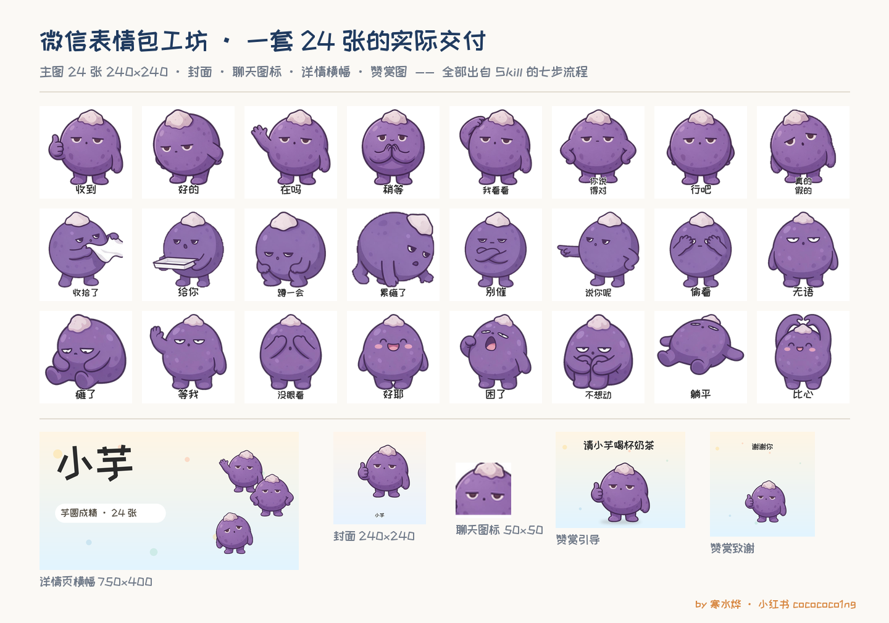

# 微信表情包工坊 · WeChat Sticker Studio

> 把一个角色设定，变成一整套拿得去送审的微信表情包。
> Turn one character sheet into a complete, submission-ready WeChat sticker pack.

[](#版权--license)
[](#版权--license)

---



> **作者跑通了全流程：八套表情包已上架微信表情开放平台。**
> 这个 Skill 是把那八套的返工记录倒推成的流程——不是教程，是踩坑清单。
> 要商用、要代做，见文末「商业使用」。

## 这是什么 / What it is

一个 Agent Skill（Agent Skills 开放格式）。装上之后，AI 会按固定七步帮你做一套表情包：定角色、写锚定段、出九宫格提示词、切格、去背、做配套图、跑质检。

An Agent Skill in the open Agent Skills format. Once installed, the agent walks a fixed seven-step pipeline: character sheet → anchor prompt → 3×3 grid prompts → cell cropping → background removal → companion images → QA.

**它不生成图片。** 出图仍然用即梦、豆包或本地模型；这个 Skill 管的是流程、参数和验收标准。

**It does not generate images.** You still render with Jimeng, Doubao, or a local model. This skill owns the process, the parameters, and the acceptance checks.

---

## 它解决什么问题 / The problem it solves

做一套 24 张的表情包，最费时间的不是画，是返工。下面每一条都是真实踩过的：

Making a 24-sticker pack: the hard part isn't drawing, it's avoiding rework. Every item below actually happened:

| 返工 / Rework | 原因 / Cause |
|---|---|
| 24 张全部重切 | 切图没内缩，格子间的白线被切进图里 / no inset, so grid lines got cropped into the cells |
| 角色白肚皮被抠没，重做 | 用"全局删白"去背 / used global white removal instead of flood fill |
| 传到平台才发现尺寸不对 | 规格没在出图前锁死 / spec not locked before rendering |
| 送审顺序错，横幅变成第 17 张表情 | 先传了表情，后传横幅 / uploaded the stickers before the banner |

这七步存在的意义只有一个：**不让 24 张画完了才发现白做。**

The whole point of the seven steps: **never discover the waste after all 24 are finished.**

---

## 七步流程 / The seven steps

| # | 步骤 | Step | 关键点 |
|---|---|---|---|
| 1 | 角色设定卡 | character sheet | 八项字段，缺一项不写提示词 |
| 2 | 锚定段 | anchor prompt | 中英各一段，只写不变的东西 |
| 3 | 九宫格提示词 | grid prompts | 三张，每张九个姿态写死 |
| 4 | 出图 | render | 先传参考图，强度 0.55–0.75 |
| 5 | 切格 / 去背 / 加字 | crop, cut out, type | 内缩 3.5%，四边泛洪 |
| 6 | 配套图 | companion images | 封面 / 图标 / 横幅 / 赞赏图 |
| 7 | 质检 + 送审 | QA and submission | 脚本先跑，再交人 |

每一步的具体参数、正反例、补救句，都在 `references/` 里。

Detailed parameters, good/bad examples and recovery prompts live in `references/`.

---

## 安装 / Install

放进你所用 Agent 的 skills 目录：

Drop the folder into your agent's skills directory:

```bash
# 先下载或 clone 本仓库 / download or clone this repo first

# Claude Code
cp -r wechat-sticker-studio ~/.claude/skills/

# Codex
cp -r wechat-sticker-studio ~/.codex/skills/

# DeepSeek Harness
cp -r wechat-sticker-studio ~/.dsh/skills/
```

目录结构 / Layout:

```
wechat-sticker-studio/
├── SKILL.md                 入口 / entry point
├── references/              五篇参考 / five references
├── scripts/check_pack.py    零依赖质检 / zero-dependency QA
└── LICENSE
```

---

## 用法 / Usage

装好之后直接说人话，不用记命令：

Just talk to the agent — no commands to memorize:

```
帮我做一套 24 张的表情包，角色是只圆滚滚的团子
```

```
这套图我出好了，帮我检查尺寸和透明通道
```

```
表情包送审要注意什么？
```

Agent 会先问你四件事（角色是谁、有没有方言梗、16 还是 24 张、用什么工具出图），然后按七步走。

The agent first asks four questions (who the character is, any dialect catchphrase, 16 or 24 stickers, which renderer), then runs the pipeline.

---

## 规格速查 / Spec sheet

| 图 / Asset | 像素 / Pixels | 体积 / Max size | 透明 / Alpha |
|---|---|---|---|
| 主图 ×N | 240×240 | ≤500KB | 要 / yes |
| 缩略图 ×N | 120×120 | ≤50KB | 要 / yes |
| 封面 / cover | 240×240 | ≤500KB | 要 / yes |
| 聊天面板图标 / icon | 50×50 | ≤30KB | 要 / yes |
| 详情页横幅 / banner | 750×400 | ≤500KB | 不用 / no |
| 赞赏引导 / tip image | 750×560 | — | — |
| 赞赏致谢 / thanks image | 750×750 | — | — |

> 平台规则会改，以页面当时显示为准。
> Platform rules change — always confirm on the live page.

---

## 内置质检 / Built-in QA

```bash
python scripts/check_pack.py <表情包目录> --expect 24
```

只读 PNG 头，不加载图像库，零依赖。逐张检查尺寸、体积、透明通道、命名补零，输出 PASS / FAIL 表；只要有一张 FAIL，就以退出码 1 结束。

Reads PNG headers only, no image library, zero dependencies. Checks dimensions, file size, alpha channel and zero-padded naming, then prints a PASS/FAIL table. Exits 1 on any failure.

```
FILE              TYPE   PIXELS     FILE SIZE ALPHA RESULT
01.png            MAIN   240x240    18.4KB    yes   PASS
banner.png        BANNER 750x400    35.6KB    no    PASS
```

---

## 版权 / License

**仅限个人学习、研究与交流使用。禁止任何形式的商业使用。**

**Personal learning, research and discussion only. Any commercial use is prohibited.**

明确禁止 / Specifically prohibited:

- 接单、代做、代上架、为客户制作 / freelance work, client production, uploading on behalf of clients
- 用本 Skill 产出的表情包上架、销售、接受赞赏 / publishing, selling or monetizing output
- 在付费社群、课程、直播里使用或演示 / use in paid communities, courses or livestreams
- 转售本包或其改写版、精简版、换皮版 / reselling this package or any derivative
- 打包进任何付费产品 / bundling into any paid product
- 删掉署名后二次分发 / redistributing with attribution removed
- 洗稿后当成自己的 Skill 再发布 / rewording and republishing as your own skill

**以上限制不适用于作者本人。** / **These restrictions do not apply to the author.**

> **需要商用授权，或者要我直接帮你做一套？** 小红书 `cocococo1ng` 私信，说明用途即可。
> 个人学习、自己发一套玩玩，不需要联系我。
>
> **Need a commercial license or a done-for-you pack?** DM cocococo1ng on Xiaohongshu. Personal use needs no permission.

引用须注明：作者 @寒水烨（小红书 `cocococo1ng`）· 作品《微信表情包工坊》+ 原链接。

Attribution required: author @HanShuiYe (Xiaohongshu `cocococo1ng`), work "WeChat Sticker Studio", plus the original link.

---

## 作者 / Author

**寒水烨** · 小红书 `cocococo1ng`

**八套表情包已上架微信表情开放平台**，这个 Skill 就是那八套踩过的坑倒推出来的流程。
有问题、想商用、要我代做，私信我。更新看小红书，GitHub 这里只放流程。

Eight sticker packs later, this is the accumulated scar tissue. Questions, commercial use, or done-for-you packs: DM me on Xiaohongshu.

---

*示例角色「团子」为虚构教学角色，不涉及任何第三方 IP、肖像或素材。*
*The sample character "Tuanzi" is fictional, used for teaching only. No third-party IP, likeness or assets are involved.*
